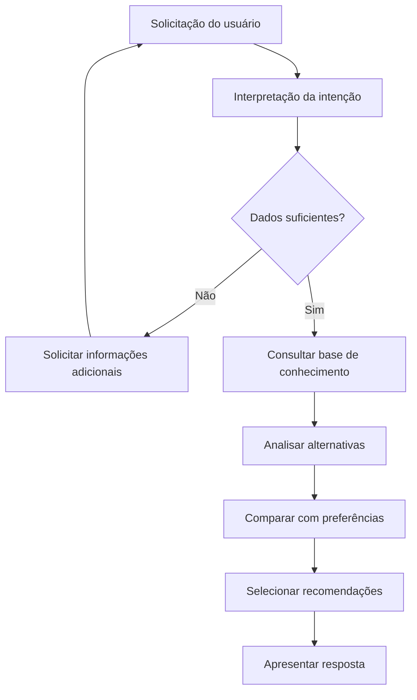

# 🚌 Atalhos - O aplicativo que encurta seu percurso

**Atalhos** é uma plataforma inteligente de mobilidade urbana que utiliza agentes de Inteligência Artificial para ajudar passageiros a planejar seus deslocamentos no transporte público.

> **Mais do que indicar caminhos, queremos ajudar cada passageiro a decidir como chegar ao seu destino.**

---

## Objetivo do projeto

Tornar o transporte público mais acessível, previsível e fácil de utilizar, oferecendo informações contextualizadas e recomendações que consideram as necessidades individuais de cada passageiro.

## Principais funcionalidades

- **Planejamento inteligente de trajetos:** recomenda caminhos considerando as necessidades e preferências do passageiro.
- **Interação por linguagem natural:** permite que o usuário faça solicitações de maneira simples e conversacional.
- **Informações contextualizadas:** consulta uma base de conhecimento sobre linhas, itinerários e funcionamento do transporte público.
- **Recomendações personalizadas:** avalia diferentes alternativas para indicar opções adequadas à realidade do usuário.
- **Avaliações de veículos e motoristas:** permite registrar avaliações vinculadas ao número do veículo e à data e horário do percurso.

## Inteligência Artificial

A solução utiliza uma arquitetura **multi-agente**, na qual diferentes agentes especializados colaboram para interpretar solicitações, consultar informações e avaliar alternativas de deslocamento.


### Fluxo de funcionamento do agente de IA

O agente do Atalhos recebe solicitações em linguagem natural, identifica as necessidades do passageiro, consulta informações sobre o transporte público e apresenta recomendações personalizadas.

<details>
<summary>Inputs (Entradas)</summary>

Informações fornecidas pelo usuário:

- Origem e destino.
- Horário desejado.
- Preferências de deslocamento.
- Necessidades específicas de mobilidade.

</details>

<details>
<summary>Processamento (Lógica)</summary>

1. **Interpretação:** identifica as informações e intenções da solicitação.
2. **Validação:** verifica se existem dados suficientes para planejar o trajeto.
3. **Consulta:** utiliza ferramentas e RAG para recuperar informações sobre linhas, paradas e itinerários.
4. **Análise:** compara as alternativas encontradas considerando as preferências do usuário.
5. **Recomendação:** seleciona as opções mais adequadas.
6. **Resposta:** apresenta os resultados em linguagem natural.

</details>

<details>
<summary>Outputs (Saídas)</summary>

Informações apresentadas ao passageiro:

- Alternativas de trajetos.
- Linhas e paradas recomendadas.
- Sequência de deslocamento.
- Tempo estimado de viagem, quando disponível.
- Quantidade de baldeações.
- Justificativa da recomendação.

</details>

### 📊 Diagrama do fluxo




## tecnologias utilizadas

| Tecnologia | Aplicação |
|---|---|
| **Gemini** | Modelo de linguagem responsável pela interpretação de solicitações e geração de respostas. |
| **Groq** | Plataforma de inferência utilizada para executar modelos de linguagem com baixa latência. |
| **RAG** | Técnica que permite consultar uma base de conhecimento antes de gerar respostas, fornecendo informações mais contextualizadas. |
| **Python** | Desenvolvimento e integração das funcionalidades de IA e processamento de dados. |
| **API** | Comunicação entre frontend e backend, possibilitando o envio e recebimento de informações. |


## Visão geral da arquitetura

```text
              ┌──────────────────┐
              │    FRONTEND      │
              │ React + TS       │
              └────────┬─────────┘
                       │
                       ▼
              ┌──────────────────┐
              │    BACKEND       │
              │   TypeScript     │
              └────────┬─────────┘
                       │
              ┌────────┴─────────┐
              ▼                  ▼
      ┌──────────────┐   ┌──────────────┐
      │  Agentes IA  │   │  Banco de    │
      │ Python       │   │  Dados       │
      │ Gemini/Groq  │   │ PostgreSQL   │
      │ RAG          │   │ SQLite       │
      └──────────────┘   └──────────────┘
```

## Impacto esperado

- Maior autonomia para os passageiros.
- Mais previsibilidade nos deslocamentos.
- Facilidade de acesso às informações do transporte público.
- Recomendações mais adequadas às necessidades individuais.
- Melhoria na experiência de utilização do transporte coletivo.

---

## 📌 Status do projeto

🚧 Em desenvolvimento.

---

**Atalhos — Menos incerteza, mais caminhos.** 🚌
